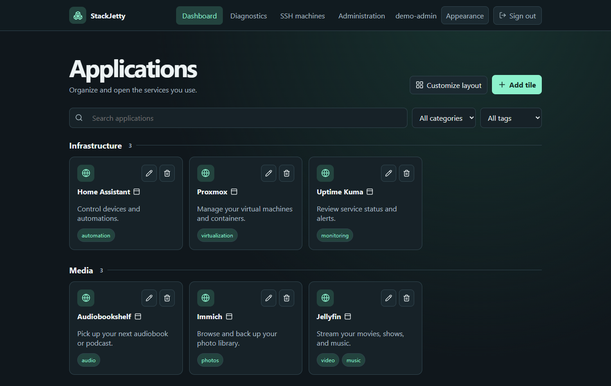
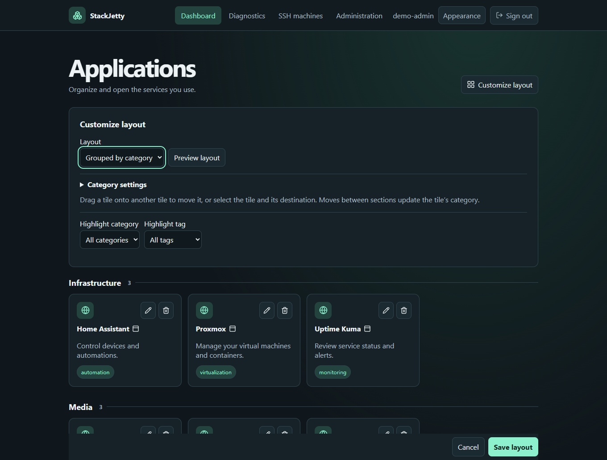
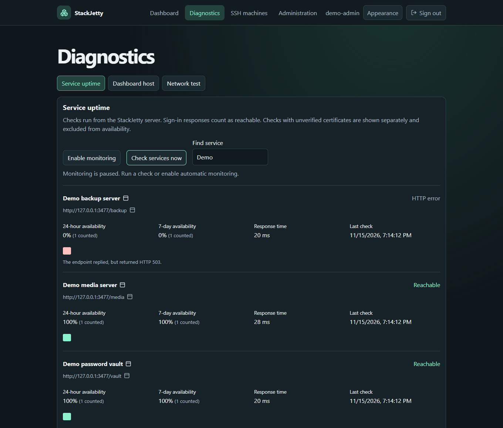
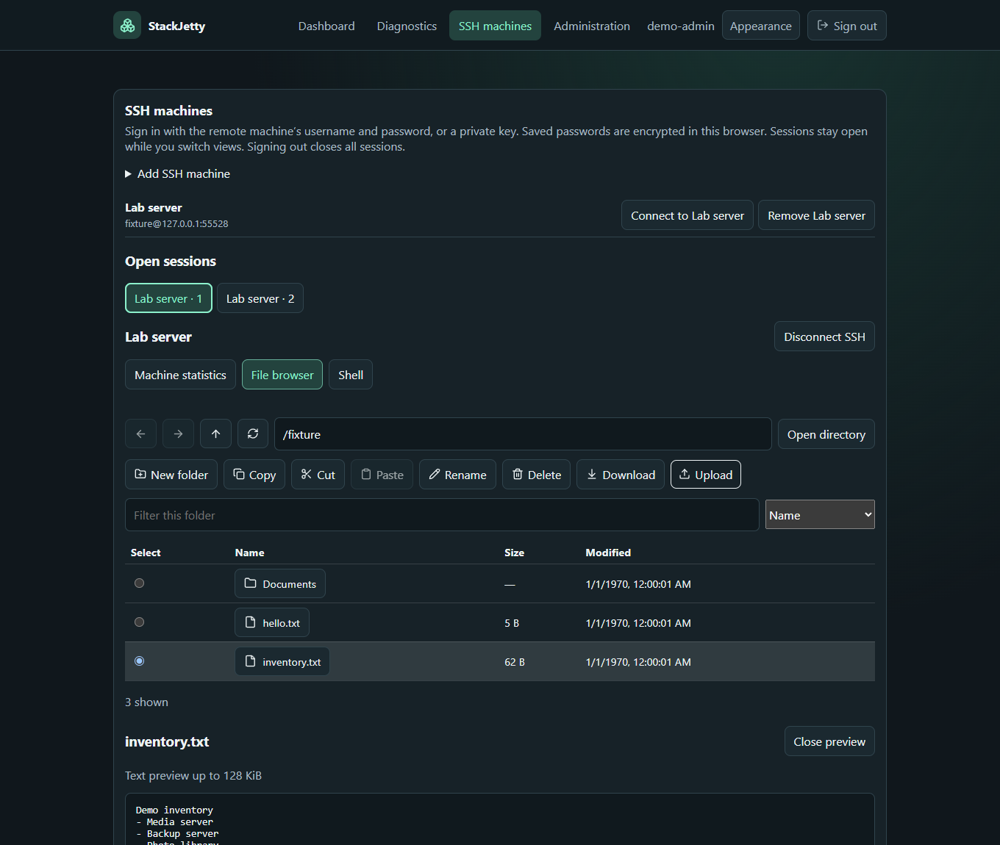
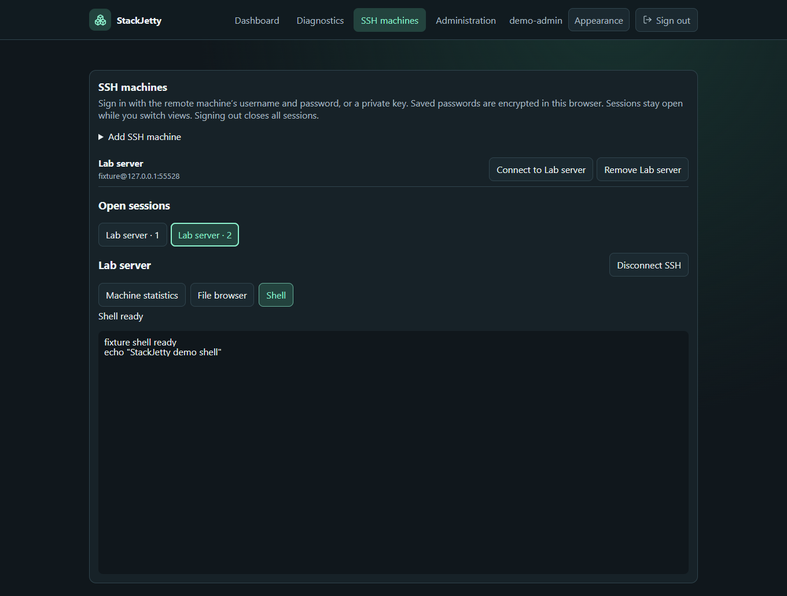

# StackJetty Dashboard

A self-hosted dashboard for your homelab. Discover services, organize them into searchable tiles, and check on the machines that run them.

**Development preview** · [Get started](#get-started) · [Screenshots](#screenshots) · [Documentation](#documentation)



## Features

| Feature | What you can do |
| --- | --- |
| Application dashboard | Create, edit, and delete tiles. Group tiles by category, add multiple tags, and combine search with category and tag filters. |
| Personal layouts | Rearrange cards directly in their category sections or on a custom grid. Adjust widths, category labels, order, and dividers, then preview the layout before saving. |
| Appearance | Choose a light, dark, or system theme and comfortable or compact cards. |
| Service view and vault | Open compatible services inside StackJetty and save logins in an encrypted browser vault. Choose a default or per-tile opening mode for a new browser tab, direct embedding, or Kasm. |
| Service discovery | Scan reachable private IPv4 subnets with CIDRs, address ranges, exclusions, custom ports, reusable profiles, progress, and cancellation. Compare scans and review live identification evidence before importing or updating tiles. |
| Accounts and access | Create editor and viewer accounts, organize user groups, and restrict individual tiles by account or group. Shared read-only access is also available. |
| Tile backups | Export tiles as JSON; review new entries and explicitly update matching URLs. Save named server-side configuration snapshots and preview restore changes. Operators can also create and recover consistent full-database backups. |
| Jellyfin activity | Show the active stream count on a matching tile after configuring a Jellyfin URL and API key on the server. |
| Ubuntu deployment | Stage a built release and install it as a systemd service under a dedicated account. |
| Diagnostics | Monitor saved URLs, inspect uptime history and host metrics, measure browser-to-server throughput, and open service links using the tile's launch preference. The monitor identifies certificate verification failures separately. |
| SSH machines | Verify a host key on first connect, sign in with a password or key, and switch between concurrent sessions. View Linux metrics, open a responsive terminal, and use the SFTP file manager to create folders, rename, cut, copy, paste, delete, upload, and download. Saved passwords use an optional encrypted browser vault. |

StackJetty stores its state locally in SQLite and has no application telemetry. See the [release readiness audit](docs/RELEASE_READINESS.md) for deployment and recovery checks, and [Privacy](PRIVACY.md) for data handling.

## Get started

For a **fresh Ubuntu server**, copy the matching StackJetty installer bundle to the server. From the directory containing the bundle, run:

```bash
sudo bash stackjetty-install.sh
```

The installer prompts for your dashboard URL, installs missing system packages, and starts StackJetty as a systemd service. Follow its instructions to create the administrator in your browser. See the [Ubuntu installation guide](docs/INSTALL.md#one-command-install-from-a-bundle) for obtaining or building the bundle and verifying it before installation.

For **local development**, open **Code** on this repository's GitHub page. Copy the clone URL into your Git client, use **Open with GitHub Desktop**, or choose **Download ZIP** to try the app without Git history. Then follow the [local development guide](docs/LOCAL_DEVELOPMENT.md) for your operating system.

## Screenshots

These screenshots show StackJetty running with demo data. Select a view to expand it.

<details>
<summary>Personal layout editor</summary>



</details>

<details>
<summary>Service diagnostics</summary>



</details>

<details>
<summary>SSH file manager and terminal</summary>





</details>

## Documentation

| Guide | Contents |
| --- | --- |
| [User guide](docs/USER_GUIDE.md) | Setup, tile editing, layouts, discovery, import, access, backups, and Jellyfin. |
| [Diagnostics and SSH](docs/DIAGNOSTICS.md) | Uptime checks, host metrics, network tests, verified SSH connections, saved passwords, file management, and terminal sessions. |
| [Security and remote access](docs/SECURITY.md) | Audit findings and Cloudflare Access deployment checklist. |
| [Ubuntu installation](docs/INSTALL.md) | Build a release, install with systemd, configure HTTPS, and back up or recover a deployment. |
| [Local development](docs/LOCAL_DEVELOPMENT.md) | Build, test, and run on Linux, macOS, or Windows. |
| [Service port catalog](docs/HOMELAB_PORTS.md) | Web ports used by discovery and how StackJetty chooses a service name. |
| [Architecture and API](ARCHITECTURE.md) | Application layout, data model, authorization, and API reference. |
| [Contributing](CONTRIBUTING.md) | Development workflow, verification, and documentation requirements. |
| [Changelog](CHANGELOG.md) and [roadmap](docs/DEVELOPMENT_STATUS.md) | Implemented changes, remaining work, and release milestones. |
| [UI audit](docs/UI_AUDIT.md) and [requirements audit](docs/REQUIREMENTS_AUDIT.md) | What has been exercised and which requirements remain open. |
